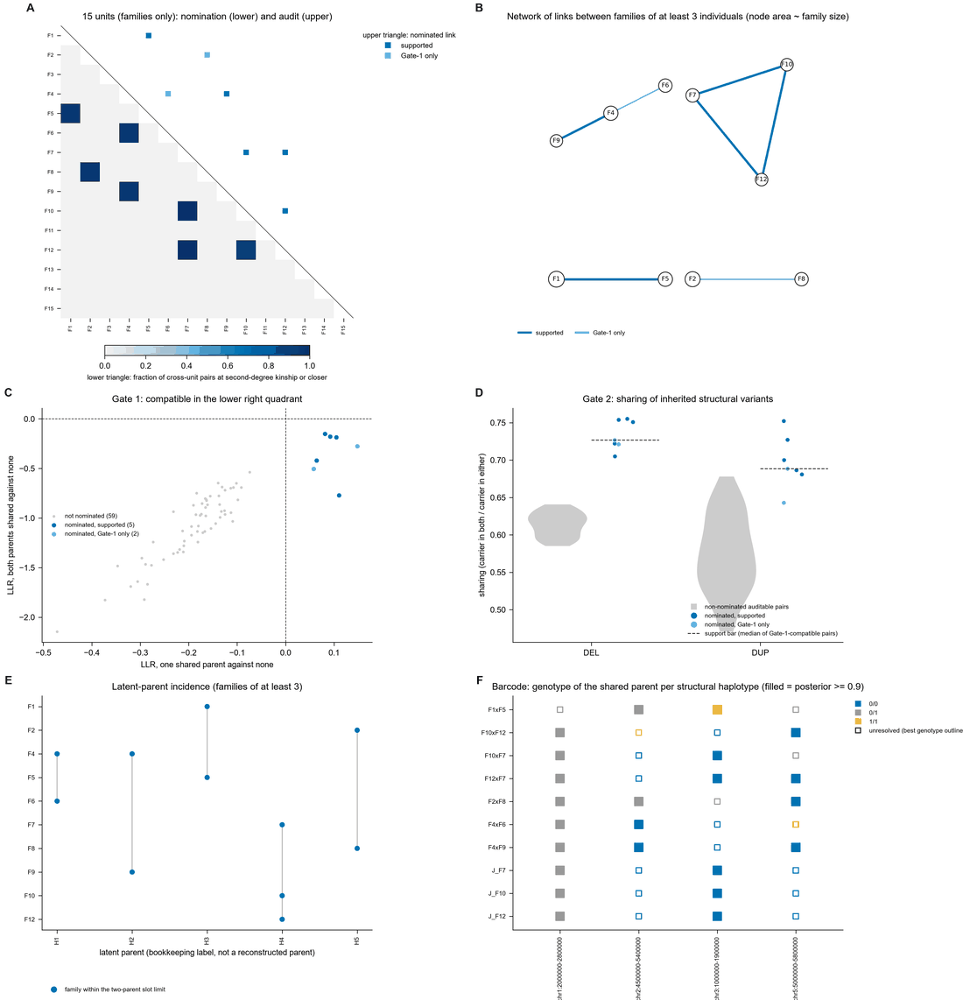
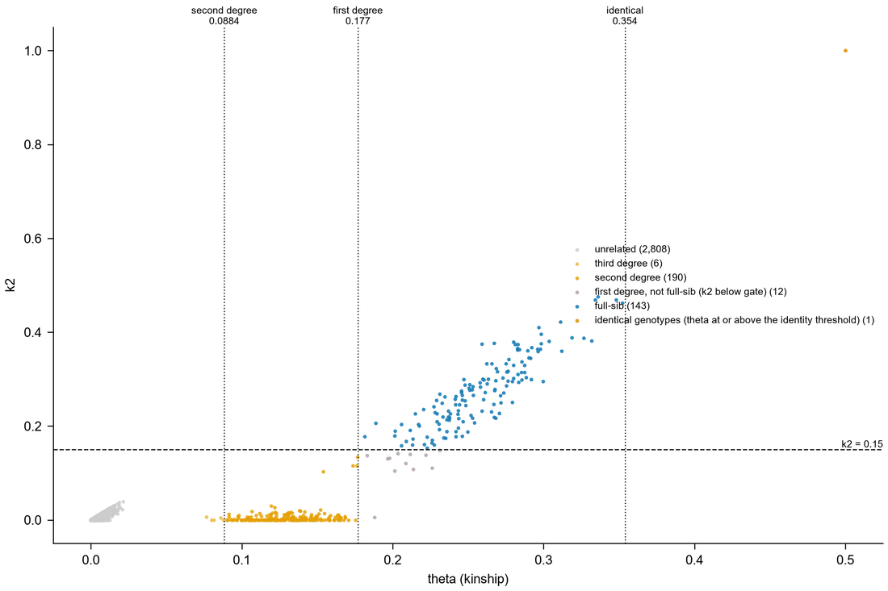
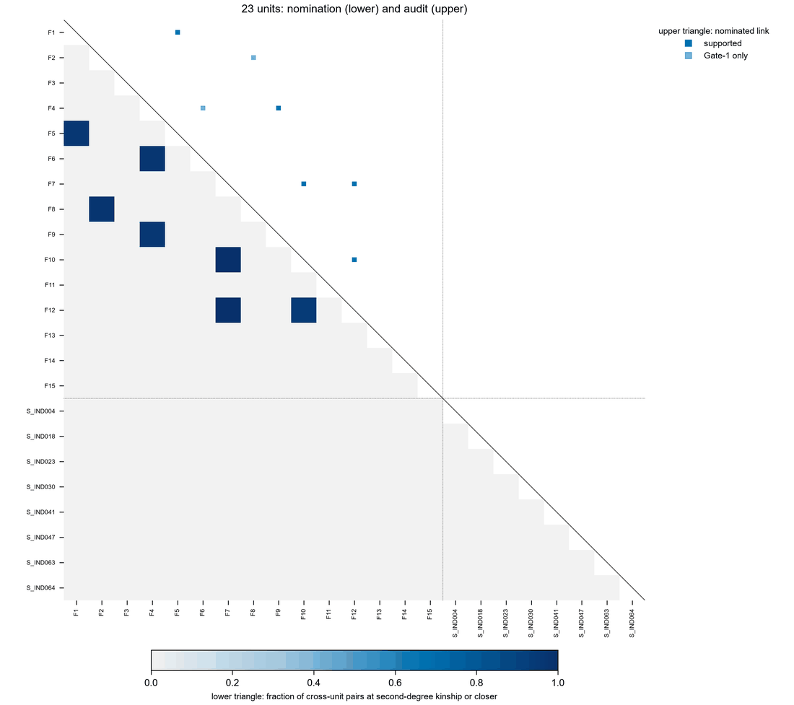
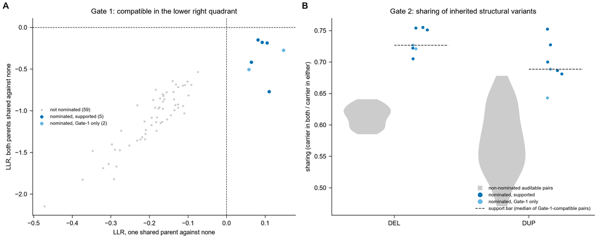
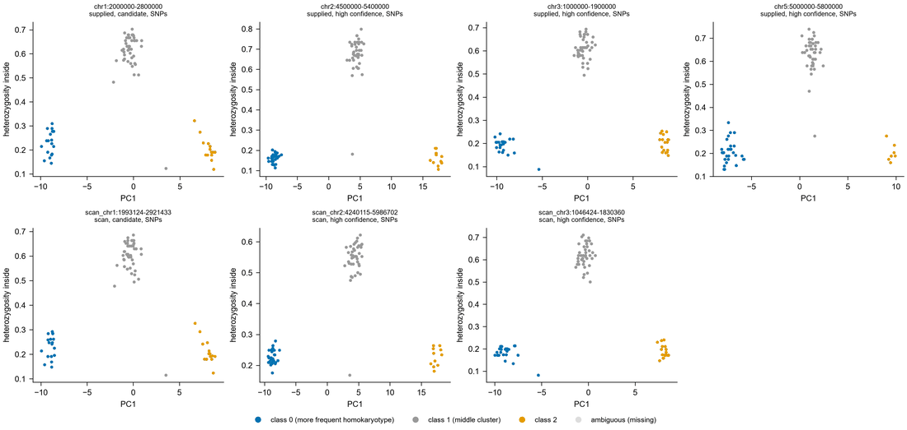
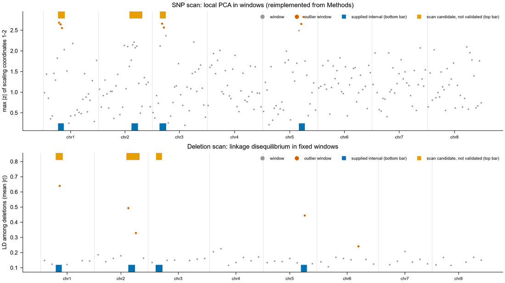
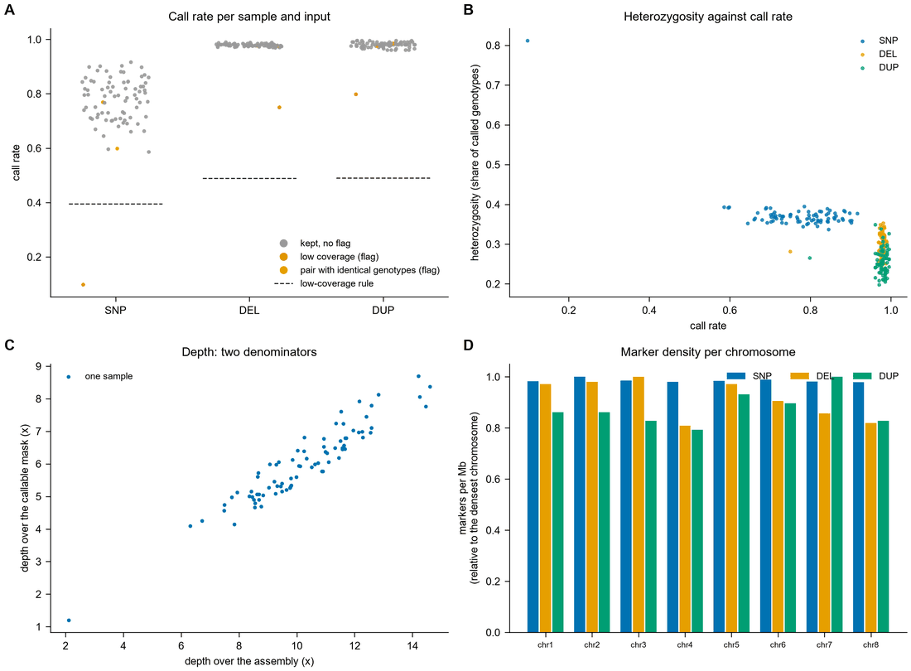
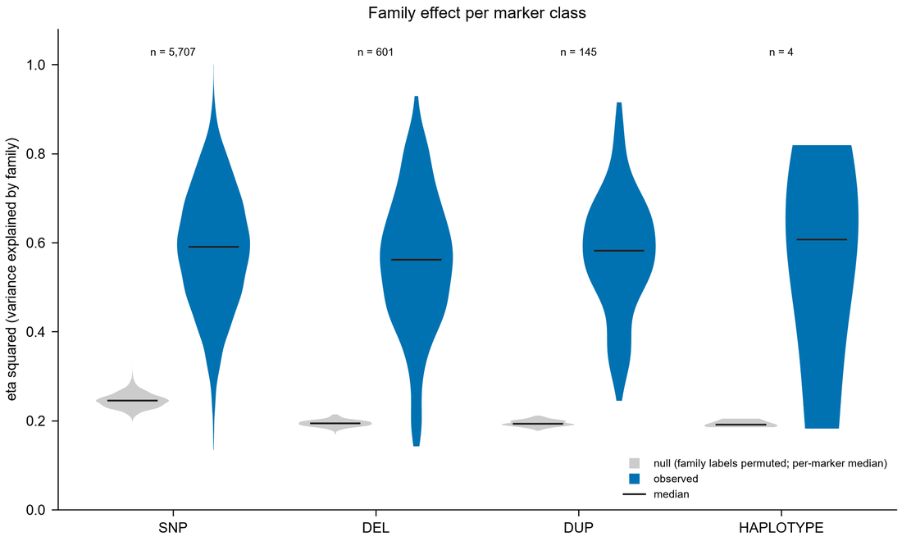
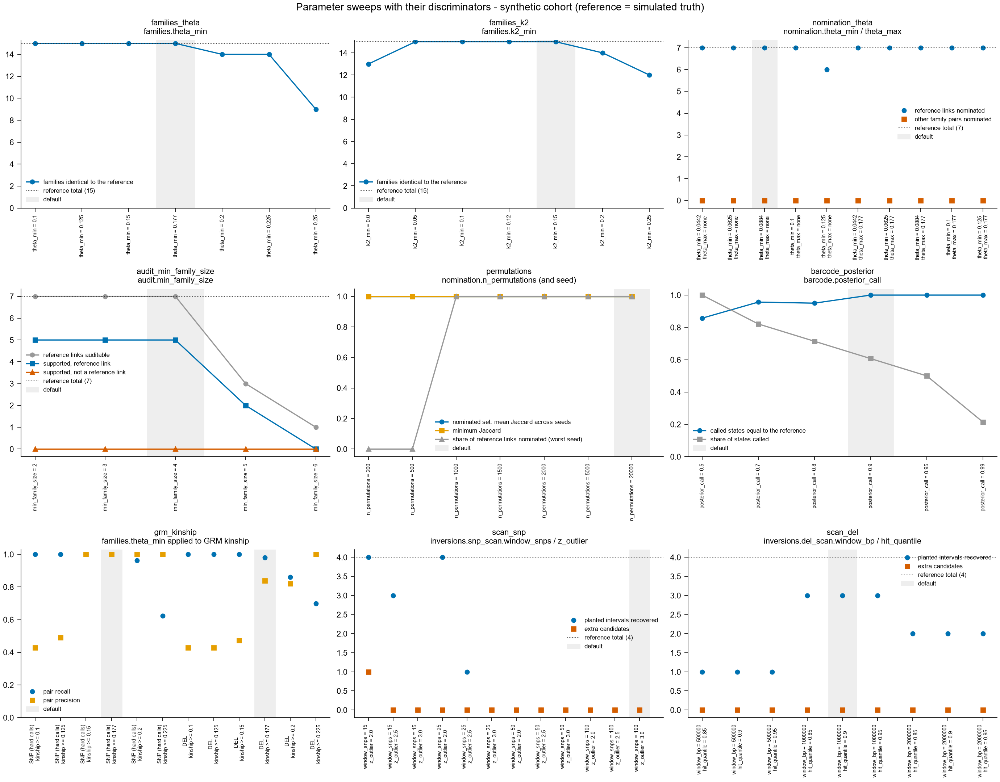

# BroodLink

**Full-sib families, candidate shared-parent links and structural-haplotype barcodes from one
cohort of related individuals without a pedigree.**

Author: Quentin Andres. Version 0.1.0. Licence: MIT.

BroodLink is a Python command-line pipeline for cohorts such as hatchery broodstock: a few
hundred individuals, many of them siblings, sequenced at low coverage, with no pedigree
records. From the inputs you have, one command runs quality control, relatedness, family
reconstruction, half-sib screening, an independent audit of the candidate links, the network
of families, and (when large structural haplotypes such as inversions are present) the
genotype of each shared parent at them. It writes tables, statistics, figures, browser
tracks, a run report and a Methods paragraph.

The analysis logic was extracted from the scripts of one study (a doctoral thesis chapter on
African catfish broodstock) and generalised. The refactored code returns that study's numbers
from its intermediate tables ([docs/REPRODUCTION.md](docs/REPRODUCTION.md)). It has been run on
two data sets: that cohort and a simulated one. Please read [Limits](#limits) before using it.

## How to run

You need Python 3.10 or later and git. Everything below takes a few minutes.

**1. Get the code**

```bash
git clone https://github.com/<github-user>/broodlink.git
cd broodlink
```

**2. Make a clean environment and install BroodLink**

With conda / mamba:

```bash
mamba create -y -n broodlink python=3.12
mamba activate broodlink
pip install .
```

Or with plain Python: `python -m venv venv`, then `source venv/bin/activate`
(Windows: `venv\Scripts\activate`), then `pip install .`

**3. Run it on the example data** (simulated, included in the repository)

The basic run needs only two files from whole-genome resequencing: SNP genotype likelihoods
(Beagle, from ANGSD) and deletion / duplication genotype calls (VCF, such as those obtained
from Manta or DELLY2):

```bash
broodlink run --bisnp tests/data/snps.beagle.gz --gt tests/data/sv.vcf.gz --out broodlink_out
```

From these two files BroodLink works out relatedness and the full-sib families, nominates
and audits the shared-parent links (the deletions are the audit markers), scans the genome
for candidate polymorphic inversions (polyINVs) by local PCA, genotypes them, and infers the
genotype of each shared parent at them (the barcode).

Every other input is optional and adds something: a relatedness table computed from the
likelihoods (`--relatedness`, e.g. NGSrelate, gives k2 and is more accurate at low
coverage), known polyINV intervals (`--inversions`), a callable mask, the assembly index,
sample metadata and depth for QC. The full example with all of them:

```bash
broodlink run --relatedness tests/data/relatedness.tsv --bisnp tests/data/snps.beagle.gz \
    --gt tests/data/sv.vcf.gz --inversions tests/data/inversions.bed \
    --mask tests/data/callable.bed --genome tests/data/genome.fai \
    --samples tests/data/samples.tsv --depth tests/data/depth.tsv \
    --config example/config.example.yaml --out broodlink_out
```

The run prints each step as it goes (`[3/10] 03_nomination: ...`), a progress line for the
long loops, and the headline result of each step. Add `--quiet` for one line per step.

**4. Look at the results**, all in `broodlink_out/`:

- `run_report.md`: start here (what ran, what was found, how far to trust it)
- `figures/`: every plot, PNG and PDF, drawn automatically
- `tables/`: every result table, TSV and one Excel file
- `statistics.tsv`: the headline numbers

**5. Run it on your own data**: give whichever inputs you have (see [Inputs](#inputs));
at least one of `--relatedness`, `--bisnp`, `--gt`, `--snp_indel` or `--vcf`. For example:

```bash
broodlink run --relatedness my_ngsrelate.res --gt my_delly.vcf.gz --out my_run
```

`broodlink run --help` lists every option. The expected results of the example are in
[example/expected/](example/expected/), and a test compares against them.

The example data are simulated by `tests/data/simulate_pedigree.py` (80 individuals,
15 full-sib families of 2 to 8, seven pairs of families sharing one parent, 8 unrelated
individuals, one sample genotyped twice, one low-coverage sample, four inversion-like
intervals). On this cohort the example run finds the 15 families, nominates the 7 true links
and no other, labels 5 of them "supported", and calls 17 of 28 shared-parent genotypes, all
17 correct.

Run the tests with `pip install pytest && pytest` (38 tests, about five minutes; the unit
tests alone, `pytest tests/test_units.py`, take under a minute).

## Inputs

At least one of `--bisnp`, `--gt`, `--snp_indel`, `--vcf`, `--relatedness`; none is
mandatory. File types and marker classes are detected and printed at the start of a run,
with what each will be used for.

| Option | What | Used for |
|---|---|---|
| `--relatedness FILE_OR_DIR` | pairwise relatedness: NGSrelate `.res` (or a folder of them), KING `.kin` / `.kin0`, or a TSV with `id1, id2, theta` (or `kinship`) and optionally `k0, k1, k2` | families and nomination, used as is |
| `--bisnp FILE ...` | biallelic SNPs: ANGSD Beagle genotype likelihoods, or VCF with GL / PL | structural-haplotype genotyping and scan; relatedness only when no table is given (see Limits) |
| `--gt FILE` (repeatable) | deletion / duplication genotype calls from whole-genome resequencing (VCF with GT, such as those obtained from Manta or DELLY2; class read from `SVTYPE`), or a genotype matrix TSV | audit, family effect; relatedness by GRM when it is the densest input |
| `--snp_indel FILE` | small-variant VCF / gVCF with GT | as `--gt`, one class |
| `--vcf FILE` (repeatable) | any other VCF with GT | as `--gt` |
| `--haplotypes FILE` | genotypes 0/1/2 of large structural haplotypes per individual | barcode (overrides pipeline calls) |
| `--inversions BED` | intervals of large structural haplotypes | genotyped by local PCA |
| `--mask FILE` (repeatable), `--mask-exclude BED` | callable regions (BED, or soft-masked FASTA) | restricts every marker class; denominator of per-base numbers |
| `--samples FILE`, `--depth FILE_OR_DIR`, `--genome FAI` | sample list / metadata, depth, chromosome lengths | QC, sample order |
| `--families FILE` | family labels from elsewhere | skips reconstruction |
| `--config FILE` | thresholds and permutation counts ([config.yaml](config.yaml) lists every default) | |

`broodlink run` runs everything. Each step can be re-run alone (`broodlink qc`,
`relatedness`, `families`, `nominate`, `audit`, `network`, `haplotypes`, `barcode`,
`family-effect`, `concordance`); `broodlink report` rebuilds tables, figures and reports;
`broodlink sweep` and `broodlink benchmark` produce the results summarised below.

## What you get

```
broodlink_out/
  run_report.md  statistics.tsv  methods_text.md  config_used.yaml
  00_qc/  01_relatedness/  02_families/  03_nomination/  04_audit/  05_network/
  06_structural_haplotypes/  07_barcode/  08_family_effect/  09_cross_marker_concordance/
  tables/ (TSV + one XLSX with a definitions sheet)   figures/ (PNG 450 dpi + PDF)   tracks/ (GFF3, BED)
```

Every folder has a `README.txt` describing its files and columns. Every table starts with
header lines giving the version, configuration hash, analysis set, marker classes, callable
span, and the sentence "Families are relatedness-based groups, not pedigree records."

## Capabilities

| Step | What it does | Needs | Origin of the code | Status in 0.1.0 |
|---|---|---|---|---|
| 0 QC | per-sample and per-input tables, flags (low coverage, identical genotypes, possible contamination, missing samples, sex / batch effects), exclusion table; flags only, removal on request | any input | reimplemented from the written Methods | runs; tested on synthetic data |
| 1 Relatedness | uses the supplied table; otherwise a VanRaden GRM (kinship = GRM / 2) of the densest genotype input | `--relatedness`, or genotypes | GRM extracted | reproduced on the original cohort |
| 2 Families | connected blocks of full-sib pairs (theta >= 0.177 and k2 >= 0.15); closure and membership class reported | step 1 | extracted | reproduced (51 families) |
| 3 Nomination | excess of cross-unit pairs at second-degree kinship or closer against a size-matched permutation null; BH q < 0.05 | step 2 | extracted | reproduced (90 pairs) |
| 4 Audit | Gate 1: likelihood of one shared parent; Gate 2: sharing of inherited structural variants against matched pairs | genotypes not used for nomination | extracted | reproduced (12 audited, 11 pass, 6 supported) |
| 5 Network | components, latent parents per size tier, two-parent slot limit | step 3 | extracted | reproduced |
| 6a Structural haplotypes | local-PCA genotyping of intervals with five criteria; deletion-based genotyping; tag variants; sub-clusters | SNPs or deletions, `--inversions` | extracted | differs in part: SNP calls agree with the published calls for a median 98% of individuals per interval, at least 95% in 33 of 41 intervals, below 80% in 5; tiers equal for 40 of 41 |
| 6a scan | SNP scan (local PCA in windows) and deletion scan (LD in windows) | SNPs or deletions | SNP scan reimplemented from Methods; deletion scan extracted | runs; candidates are not validated; weak recovery on the original cohort from deletions alone |
| 6b Barcode | posterior genotype of the shared parent at each structural haplotype | step 6a or `--haplotypes`, and links | extracted | reproduced (25 of 41 states at 0.90) |
| 7 Family effect | eta squared per marker class against permuted family labels | genotypes, families | extracted | reproduced (0.585 / 0.528 / 0.602) |
| 8 Concordance | kinship per marker class within and between families (AUC, recovery) | genotypes, families | extracted | reproduced; no bootstrap intervals |
| Reports | statistics with definitions, run report with capability table, Methods text, tables, 14 figures, tracks | | new | runs |

What changes with the inputs (the run report states it for every run):

- With a relatedness table and at least one genotype input: the benchmarked path.
- With `--relatedness` alone: families, nomination, network; no audit ("nominated, not audited").
- With one genotype input alone: relatedness by GRM; its markers are split by chromosome parity
  into a nomination set and an audit set; links are labelled "single-input, provisional".
- Barcode only with structural-haplotype genotypes (supplied, genotyped from `--inversions`, or
  from scan candidates passing two criteria, labelled as unvalidated).

## Figures (synthetic data)

Rendered by the example run (step 3 of [How to run](#how-to-run)); small copies are committed in `docs/figures/`.

| | |
|---|---|
|  Shared-parent overview: matrix, network, gates, incidence, barcode |  theta against k2 with thresholds |
|  Nomination (lower) and audit (upper) for all units |  Audit gates |
|  Structural haplotypes: PC1 against heterozygosity |  Scan for structural haplotypes |
|  QC panels |  Family effect per marker class |

All 14: [docs/figures/](docs/figures/). They are generic views drawn from BroodLink's tables,
not ports of the published figures ([docs/DISPLAY_ITEMS.md](docs/DISPLAY_ITEMS.md)).

## A quick benchmark

Small and clearly scoped: one simulated cohort, one real cohort, one seed. Details and
caveats in [docs/BENCHMARK.md](docs/BENCHMARK.md).

| Data | Mode | Families identical to reference | True / reference links kept | Run time |
|---|---|---|---|---|
| synthetic (truth known) | relatedness table + SNPs + SVs | 15 / 15 | 7 / 7 (5 supported), 0 false | 17 s |
| synthetic | `--bisnp` only (GRM) | 15 / 15 | 7 / 7 nominated, none can be "supported" without an SV class | 18 s |
| synthetic | `--gt` only (605 deletions, GRM) | 12 / 15 | 3 / 7 | 7 s |
| original cohort (reference = full run) | `--relatedness` only | 51 / 51 | same 90 nominated pairs; no audit | 3 min |
| original cohort | `--gt` only (17,000 deletions, GRM) | 42 / 51 | 4 of the 6 supported links, plus 2 others | 16 min |

Without k2 (any GRM mode) families that share a parent tend to merge; that is the main
weakness of the single-input modes.

## Parameter sweeps

`broodlink sweep` varies the family thresholds (theta, k2), the second-degree bound, the
minimum family size of the audit, the permutation count and seed, the barcode posterior
cut-off, the GRM kinship threshold and the scan windows. Each sweep reports a discriminator
(agreement with reference families or links, recovery of planted intervals, stability
across seeds) and the provenance of every value. Results for both data sets:
[docs/SWEEP.md](docs/SWEEP.md). In short: the defaults sit on plateaus for the family
thresholds; fewer than about 1,000 permutations cannot nominate anything; at 1,500 to 5,000
permutations the nominated set still changes a little between seeds (mean Jaccard 0.90 to
0.94 on the original cohort) while the audited links do not; the audit at a minimum family
size below 4 lets more pairs reach "supported". No default was tuned on these results.



## Limits

- **Families are relatedness-based groups, not pedigree records.** They are connected blocks
  of full-sib pairs, not complete cliques: in the original cohort 13 of 51 families contain
  at least one pair that fails a threshold (332 of 363 within-family pairs pass). Closure is
  reported per family; `families.rule: clique` is available.
- **Links are candidates.** Nomination is screening. "Supported" means compatible with one
  shared parent on Gate 1 and above a *relative* bar on Gate 2 (the median of the compatible
  pairs, so about half pass by construction). It is not proof of a shared parent, and a
  half-sib link cannot be told from other second-degree relationships between families.
- **Nomination has no upper bound on theta by default** ("second degree or closer"), as in
  the original code and Methods. `nomination.theta_max: 0.177` restricts it to the
  second-degree band; the sweep shows the effect.
- **Low coverage.** BroodLink has no likelihood-based relatedness estimator. For low-coverage
  data, compute relatedness with a dedicated tool (the original study used NGSrelate) and
  pass it with `--relatedness`. If NGSrelate is on the PATH, BroodLink calls it for `--bisnp`;
  that branch was never run. Otherwise `--bisnp` alone is hard-called (likelihood > 0.90) into
  a GRM, which underestimates half-sib kinship and has no k2.
- **GRM thresholds are not benchmarked.** The original GRM benchmark measured concordance
  (AUC, recovery) and set no family threshold and no minimum marker count. BroodLink applies
  kinship >= 0.177 because an older script of the project did, and reports the marker count
  against two observed reference points (17,276 and 1,178 markers).
- **Reimplemented from the written Methods** (no original code existed): the QC rules, and the
  SNP scan for structural haplotypes. New in BroodLink, not rules of the original analysis:
  the numeric contamination flag, the genotype-concordance flag, sex / batch tests, the SV
  mask rule, setting ambiguous structural-haplotype genotypes to missing, the tracks.
- **Scan candidates are unvalidated.** On the original cohort the deletion scan alone
  overlapped 8 of the 41 published intervals and proposed 23 others. Default SNP windows (100
  SNPs) need dense data; small genomes or sparse SNPs are skipped with a note.
- **Tested on two data sets.** One generation, diploid, one population. Not tested on
  multi-generation pedigrees, strong population structure, inbred lines or polyploids.
  Performance: 216 individuals with 20,000 deletions and 20,000 permutations run in about 20
  minutes on a laptop; inputs are held in memory.
- **Not implemented in 0.1.0:** a likelihood-based k0 / k1 / k2 estimator; bootstrap
  intervals for the concordance; the recurrence test of one parent across two links and the
  parental-slot topology test (a junction barcode assumes the same parent on every link and
  is labelled a candidate); held-out validation of links; deletion evidence against the
  barcode; the unresolved / incompatible distinction of family blocks; an exact maximum
  unrelated set (a greedy set is used); panel-by-panel ports of the published figures
  (panels B and I of the shared-parent figure, the kinship heat map); reading BCF; a
  `--bisnp`-only and a `--snp_indel`-only run on the original cohort
  ([docs/REPRODUCTION.md](docs/REPRODUCTION.md) lists what was not rerun and why).

## Documentation

- [docs/EXTRACTED_METHOD.md](docs/EXTRACTED_METHOD.md): where every step, threshold and null
  model comes from in the original scripts, and what was not found.
- [docs/REPRODUCTION.md](docs/REPRODUCTION.md): the original numbers, reproduced / differs /
  not run, with causes.
- [docs/BENCHMARK.md](docs/BENCHMARK.md), [docs/SWEEP.md](docs/SWEEP.md),
  [docs/DISPLAY_ITEMS.md](docs/DISPLAY_ITEMS.md), [CHANGELOG.md](CHANGELOG.md).

## How to cite

Andres Q. (2026) BroodLink: adaptive reconstruction of full-sib families, shared-parent links
and structural-haplotype barcodes from low-coverage cohorts. Version 0.1.0. Zenodo.
DOI: <to be assigned>. Repository: <GitHub URL>.

See [CITATION.cff](CITATION.cff). The method is described in the thesis chapter the code was
extracted from; a reference will be added when it is public.
