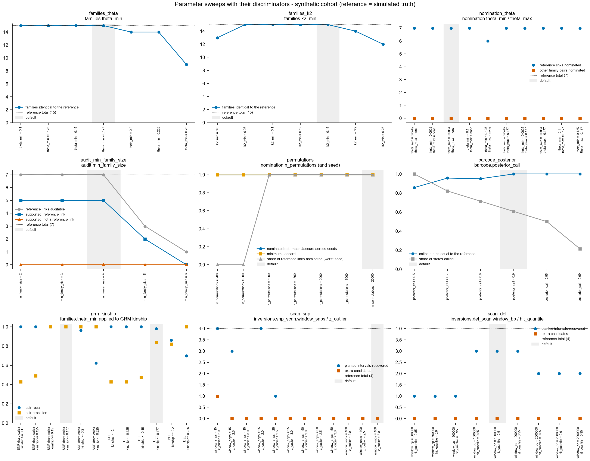

# Parameter sweeps

Every sweep below reports a **discriminator**: a measure that tells good settings from bad
(agreement with reference families, recovery of reference links or planted intervals, stability
of the nominated set across seeds). A sweep that only showed "the output changed" would not be
reported. Every sweep also carries a **provenance** note: where the default and each tested
value come from (original script and line, the written Methods, or "chosen here").

Two data sets:

1. **Synthetic cohort** (`tests/data`, 80 individuals; the reference is the simulated truth).
   Reproduce with `broodlink sweep --out sweep_out` (about 3 minutes). Tables: `docs/sweep/`.
2. **Original cohort** (216 individuals; the reference is the published full run: 51 families,
   6 supported links, 41 intervals). Here the discriminator measures agreement with that run,
   not correctness, because no pedigree exists. Run from existing intermediate tables through a
   local, git-ignored script; no sample identifier appears below.

Scope: one simulated cohort with one seed, and one real cohort. The sweeps show how sensitive
each result is around the default; they do not establish optimal values for other cohorts.
No default was changed as a result of these sweeps.

## What the sweeps show

- **Family thresholds (theta, k2).** Both data sets have a plateau around the defaults. On the
  original cohort the 51 reference families are returned for theta between 0.125 and 0.177 (at
  k2 >= 0.15), and only at k2 >= 0.15 among the k2 values tested: the older value 0.12 gives 48
  identical families of 51. Without the k2 gate, pair precision drops to 0.75 (original) and
  0.82 (synthetic), because parent-sharing families merge.
- **Second-degree bound of the nomination.** All reference links are nominated at every
  lower bound up to 0.10. The bound mostly changes how many *other* pairs are nominated
  (original cohort, 5,000 permutations: 168 unit pairs at 0.0442, 88 at 0.0884, 26 at 0.125).
  Adding the upper bound of 0.177, which is not in the original code, nominates slightly more
  pairs (93 against 88 at the default lower bound) and loses no reference link.
- **Minimum family size for the audit.** At 4 (default) every reference link is auditable and
  no supported link falls outside the reference. At 3 and 2, on the original cohort, 6 and 21
  further pairs reach "supported": the relative Gate-2 bar is less selective when small
  families enter. At 5 and 6 most reference links are no longer auditable.
- **Permutation count.** With 200 or 500 permutations nothing can be nominated: the smallest
  attainable P value, 1 / (permutations + 1), cannot pass Benjamini-Hochberg over hundreds of
  unit pairs. On the original cohort the nominated set agrees between seeds with a mean
  Jaccard index of 0.90 at 1,500 permutations and 0.94 at 5,000; the six reference links are
  nominated in every run. The total at 20,000 permutations (90) is reported in
  `REPRODUCTION.md`; a multi-seed run at 20,000 was not made on the original cohort (about 5
  minutes per seed).
- **Barcode posterior cut-off** (synthetic only; the original cohort has no parental truth).
  At 0.90 and above, every called state equals the true parental genotype (17 of 28 called at
  0.90); at 0.50, 4 of 28 calls are wrong.
- **GRM kinship threshold.** For dense markers, 0.177 is near the best trade-off (original
  cohort, SNP GRM: 46 of 51 families identical, pair precision 0.98, recall 0.99). For
  deletions on the original cohort, 0.20 gives higher precision (0.99 against 0.80) at lower
  recall (0.94 against 0.99); the default is kept at 0.177 because that is the only threshold
  the original project applied to a GRM. Duplications alone (about 1,200 markers) and the 41
  inversions alone do not recover the families at any threshold tested.
- **Scan windows.** SNP scan (reimplemented from Methods), synthetic data only: the default
  window of 100 SNPs cannot be used on the small synthetic genome (every chromosome is skipped,
  and the run says so); with 15-25 SNPs and |z| >= 2, all four planted intervals are found,
  with one extra candidate at 15 SNPs. Deletion scan: 3 of 4 planted intervals at the default
  on the synthetic data; on the original cohort 8 of the 41 published intervals overlap a
  candidate and 23 candidates overlap none. The deletion scan alone is therefore a weak
  detector of the published intervals; the SNP scan was not run on the original cohort (see
  `REPRODUCTION.md`).

## Synthetic cohort: tables

### families_theta (families.theta_min)

Discriminator: families identical to the reference; pair precision and recall.

Provenance. Default: 0.177: original toolkit common.py line 12 (THETA_FD) and get_FS.py line 50; Methods. Tested values: 0.10 to 0.25 in steps: chosen here to bracket the default; 0.25 is the expectation for full sibs.

| setting |  | families_called | families_reference | families_identical | pair_precision | pair_recall |
|---|---|---|---|---|---|---|
| theta_min = 0.1 |  | 15 | 15 | 15 | 1.0 | 1.0 |
| theta_min = 0.125 |  | 15 | 15 | 15 | 1.0 | 1.0 |
| theta_min = 0.15 |  | 15 | 15 | 15 | 1.0 | 1.0 |
| theta_min = 0.177 | default | 15 | 15 | 15 | 1.0 | 1.0 |
| theta_min = 0.2 |  | 15 | 15 | 14 | 1.0 | 0.9811 |
| theta_min = 0.225 |  | 15 | 15 | 14 | 1.0 | 0.9811 |
| theta_min = 0.25 |  | 15 | 15 | 9 | 1.0 | 0.8805 |

### families_k2 (families.k2_min)

Discriminator: families identical to the reference; pair precision and recall.

Provenance. Default: 0.15: common.py line 15 (K2_FS); Methods. Tested values: 0.12: older value in sibling_build.py line 7; 0 (gate off), 0.05, 0.10, 0.20, 0.25: chosen here.

| setting |  | families_called | families_reference | families_identical | pair_precision | pair_recall |
|---|---|---|---|---|---|---|
| k2_min = 0.0 |  | 14 | 15 | 13 | 0.8196 | 1.0 |
| k2_min = 0.05 |  | 15 | 15 | 15 | 1.0 | 1.0 |
| k2_min = 0.1 |  | 15 | 15 | 15 | 1.0 | 1.0 |
| k2_min = 0.12 |  | 15 | 15 | 15 | 1.0 | 1.0 |
| k2_min = 0.15 | default | 15 | 15 | 15 | 1.0 | 1.0 |
| k2_min = 0.2 |  | 15 | 15 | 14 | 1.0 | 0.9811 |
| k2_min = 0.25 |  | 15 | 15 | 12 | 1.0 | 0.9245 |

### nomination_theta (nomination.theta_min / theta_max)

Discriminator: reference links nominated (of the reference links) and family pairs nominated that are not reference links.

Provenance. Default: theta_min 0.0884, no upper bound: sp_lib.py line 40 (THETA_HS, common.py line 13); Methods ('second degree or closer'). Tested values: 0.0442: third-degree bound, common.py line 14; upper bound 0.177: the BroodLink task description (not the original code); 0.0625, 0.10, 0.125: chosen here.

| setting |  | n_nominated_all_units | links_called | links_true | links_false | links_missed | links_reference | n_permutations |
|---|---|---|---|---|---|---|---|---|
| theta_min = 0.0442, theta_max = none |  | 7 | 7 | 7 | 0 | 0 | 7 | 5000 |
| theta_min = 0.0625, theta_max = none |  | 7 | 7 | 7 | 0 | 0 | 7 | 5000 |
| theta_min = 0.0884, theta_max = none | default | 7 | 7 | 7 | 0 | 0 | 7 | 5000 |
| theta_min = 0.1, theta_max = none |  | 7 | 7 | 7 | 0 | 0 | 7 | 5000 |
| theta_min = 0.125, theta_max = none |  | 6 | 6 | 6 | 0 | 1 | 7 | 5000 |
| theta_min = 0.0442, theta_max = 0.177 |  | 7 | 7 | 7 | 0 | 0 | 7 | 5000 |
| theta_min = 0.0625, theta_max = 0.177 |  | 7 | 7 | 7 | 0 | 0 | 7 | 5000 |
| theta_min = 0.0884, theta_max = 0.177 |  | 7 | 7 | 7 | 0 | 0 | 7 | 5000 |
| theta_min = 0.1, theta_max = 0.177 |  | 7 | 7 | 7 | 0 | 0 | 7 | 5000 |
| theta_min = 0.125, theta_max = 0.177 |  | 7 | 7 | 7 | 0 | 0 | 7 | 5000 |

### audit_min_family_size (audit.min_family_size)

Discriminator: reference links that can be audited; supported links that are reference links / that are not.

Provenance. Default: 4: run_audit.py lines 49-50; Methods, 'Eligibility'. Tested values: 3 and 2: the extension and provisional tiers of the original; 5 and 6: chosen here.

| setting |  | auditable_pairs | reference_links_auditable | links_reference | gate1_pass_true | gate1_pass_false | rejected_true | supported_true | supported_false |
|---|---|---|---|---|---|---|---|---|---|
| min_family_size = 2 |  | 105 | 7 | 7 | 7 | 0 | 0 | 5 | 0 |
| min_family_size = 3 |  | 78 | 7 | 7 | 7 | 0 | 0 | 5 | 0 |
| min_family_size = 4 | default | 66 | 7 | 7 | 7 | 0 | 0 | 5 | 0 |
| min_family_size = 5 |  | 28 | 3 | 7 | 3 | 0 | 0 | 2 | 0 |
| min_family_size = 6 |  | 10 | 1 | 7 | 1 | 0 | 0 | 0 | 0 |

### permutations (nomination.n_permutations (and seed))

Discriminator: stability of the nominated set across seeds (mean pairwise Jaccard index) and reference links nominated.

Provenance. Default: 20,000, seed 1: the primary run of the original analysis (Methods). Tested values: 1,500: run_nomination.py and the original seed sweep (nomination_seed_sweep.tsv); 200 to 5,000 and seeds 1-5: chosen here.

| setting |  | n_seeds | nominated_min | nominated_max | jaccard_across_seeds_mean | jaccard_across_seeds_min | links_true_min | links_false_max | links_reference | seconds_per_run |
|---|---|---|---|---|---|---|---|---|---|---|
| n_permutations = 200 |  | 5 | 0 | 0 | 1.0 | 1.0 | 0 | 0 | 7 | 0.1 |
| n_permutations = 500 |  | 5 | 0 | 0 | 1.0 | 1.0 | 0 | 0 | 7 | 0.29 |
| n_permutations = 1000 |  | 5 | 7 | 7 | 1.0 | 1.0 | 7 | 0 | 7 | 0.67 |
| n_permutations = 1500 |  | 5 | 7 | 7 | 1.0 | 1.0 | 7 | 0 | 7 | 0.91 |
| n_permutations = 2000 |  | 5 | 7 | 7 | 1.0 | 1.0 | 7 | 0 | 7 | 0.99 |
| n_permutations = 5000 |  | 5 | 7 | 7 | 1.0 | 1.0 | 7 | 0 | 7 | 2.4 |
| n_permutations = 20000 | default | 5 | 7 | 7 | 1.0 | 1.0 | 7 | 0 | 7 | 15.81 |

### barcode_posterior (barcode.posterior_call)

Discriminator: share of called states equal to the reference parent genotype, against the share of states called.

Provenance. Default: 0.90: get_INV_barcode_SP_get_LP.py line 27 (--post) and lp01_profile.py line 31. Tested values: 0.95: the stricter count reported in the Methods; 0.50 to 0.99 otherwise: chosen here.

| setting |  | n_states | n_called | share_called | accuracy_of_called | n_called_wrong |
|---|---|---|---|---|---|---|
| posterior_call = 0.5 |  | 28 | 28 | 1.0 | 0.8571 | 4 |
| posterior_call = 0.7 |  | 28 | 23 | 0.8214 | 0.9565 | 1 |
| posterior_call = 0.8 |  | 28 | 20 | 0.7143 | 0.95 | 1 |
| posterior_call = 0.9 | default | 28 | 17 | 0.6071 | 1.0 | 0 |
| posterior_call = 0.95 |  | 28 | 14 | 0.5 | 1.0 | 0 |
| posterior_call = 0.99 |  | 28 | 6 | 0.2143 | 1.0 | 0 |

### grm_kinship (families.theta_min applied to GRM kinship)

Discriminator: families identical to the reference; pair precision and recall, per marker class.

Provenance. Default: 0.177 on GRM / 2: grm_verify.py line 23 and relatedness_atlas.py cluster_sibships (fs_lo); the GRM benchmark itself fixed no threshold. Tested values: 0.10 to 0.225: chosen here.

| setting |  | marker_class | n_markers | families_called | families_reference | families_identical | pair_precision | pair_recall |
|---|---|---|---|---|---|---|---|---|
| SNP (hard calls): kinship >= 0.1 |  | SNP (hard calls) | 5451 | 9 | 15 | 5 | 0.4274 | 1.0 |
| SNP (hard calls): kinship >= 0.125 |  | SNP (hard calls) | 5451 | 10 | 15 | 7 | 0.4907 | 1.0 |
| SNP (hard calls): kinship >= 0.15 |  | SNP (hard calls) | 5451 | 15 | 15 | 15 | 1.0 | 1.0 |
| SNP (hard calls): kinship >= 0.177 | default | SNP (hard calls) | 5451 | 15 | 15 | 15 | 1.0 | 1.0 |
| SNP (hard calls): kinship >= 0.2 |  | SNP (hard calls) | 5451 | 15 | 15 | 13 | 1.0 | 0.9623 |
| SNP (hard calls): kinship >= 0.225 |  | SNP (hard calls) | 5451 | 17 | 15 | 7 | 1.0 | 0.6226 |
| DEL: kinship >= 0.1 |  | DEL | 605 | 9 | 15 | 5 | 0.4274 | 1.0 |
| DEL: kinship >= 0.125 |  | DEL | 605 | 9 | 15 | 5 | 0.4274 | 1.0 |
| DEL: kinship >= 0.15 |  | DEL | 605 | 10 | 15 | 6 | 0.4732 | 1.0 |
| DEL: kinship >= 0.177 | default | DEL | 605 | 14 | 15 | 12 | 0.8387 | 0.9811 |
| DEL: kinship >= 0.2 |  | DEL | 605 | 14 | 15 | 8 | 0.8204 | 0.8616 |
| DEL: kinship >= 0.225 |  | DEL | 605 | 14 | 15 | 7 | 1.0 | 0.6981 |

### scan_snp (inversions.snp_scan.window_snps / z_outlier)

Discriminator: planted intervals overlapped by a scan candidate and candidates that overlap no planted interval.

Provenance. Default: 100 SNPs, |z| >= 3: Methods (local PCA in the style of lostruct); the scan script was not archived, the scan is reimplemented from Methods. Tested values: 15, 25, 50 SNPs and |z| 2.0, 2.5: chosen here (the synthetic genome has 750 SNPs per chromosome).

| setting |  | planted_recovered | planted_total | extra_candidates | n_candidates | chromosomes_skipped | seconds |
|---|---|---|---|---|---|---|---|
| window_snps = 15, z_outlier = 2.0 |  | 4 | 4 | 1 | 5 | 0 | 11.2 |
| window_snps = 15, z_outlier = 2.5 |  | 3 | 4 | 0 | 3 | 0 | 8.5 |
| window_snps = 15, z_outlier = 3.0 |  | 0 | 4 | 0 | 0 | 0 | 6.3 |
| window_snps = 25, z_outlier = 2.0 |  | 4 | 4 | 0 | 4 | 0 | 4.3 |
| window_snps = 25, z_outlier = 2.5 |  | 1 | 4 | 0 | 1 | 0 | 4.6 |
| window_snps = 25, z_outlier = 3.0 |  | 0 | 4 | 0 | 0 | 0 | 3.8 |
| window_snps = 50, z_outlier = 2.0 |  | 0 | 4 | 0 | 0 | 0 | 1.7 |
| window_snps = 50, z_outlier = 2.5 |  | 0 | 4 | 0 | 0 | 0 | 1.6 |
| window_snps = 50, z_outlier = 3.0 |  | 0 | 4 | 0 | 0 | 0 | 2.0 |
| window_snps = 100, z_outlier = 2.0 |  | 0 | 4 | 0 | 0 | 8 | 0.0 |
| window_snps = 100, z_outlier = 2.5 |  | 0 | 4 | 0 | 0 | 8 | 0.0 |
| window_snps = 100, z_outlier = 3.0 | default | 0 | 4 | 0 | 0 | 8 | 0.0 |

### scan_del (inversions.del_scan.window_bp / hit_quantile)

Discriminator: planted intervals overlapped by a scan candidate and candidates that overlap no planted interval.

Provenance. Default: 1 Mb windows, 90th percentile: step2_inversions.py. Tested values: 0.5 and 2 Mb, 85th and 95th percentile: chosen here.

| setting |  | planted_recovered | planted_total | extra_candidates | n_candidates | windows_tested | seconds |
|---|---|---|---|---|---|---|---|
| window_bp = 500000, hit_quantile = 0.85 |  | 1 | 4 | 0 | 1 | 39 | 0.1 |
| window_bp = 500000, hit_quantile = 0.9 |  | 1 | 4 | 0 | 1 | 39 | 0.1 |
| window_bp = 500000, hit_quantile = 0.95 |  | 1 | 4 | 0 | 1 | 39 | 0.1 |
| window_bp = 1000000, hit_quantile = 0.85 |  | 3 | 4 | 0 | 3 | 54 | 0.1 |
| window_bp = 1000000, hit_quantile = 0.9 | default | 3 | 4 | 0 | 3 | 54 | 0.1 |
| window_bp = 1000000, hit_quantile = 0.95 |  | 3 | 4 | 0 | 3 | 54 | 0.1 |
| window_bp = 2000000, hit_quantile = 0.85 |  | 2 | 4 | 0 | 2 | 32 | 0.1 |
| window_bp = 2000000, hit_quantile = 0.9 |  | 2 | 4 | 0 | 2 | 32 | 0.1 |
| window_bp = 2000000, hit_quantile = 0.95 |  | 2 | 4 | 0 | 2 | 32 | 0.1 |

## Original cohort: tables

Reference = the published full run. "links_false" and "supported_false" here mean "not among
the six supported links of the reference run"; they are not known to be false. The barcode
and SNP-scan sweeps were not run on this cohort (no parental truth; raw likelihoods needed).
Nomination sweeps used 5,000 permutations.

### families_theta (families.theta_min)

Discriminator: families identical to the reference; pair precision and recall.

(Provenance as in the synthetic section.)

| setting |  | families_called | families_reference | families_identical | pair_precision | pair_recall |
|---|---|---|---|---|---|---|
| theta_min = 0.1 |  | 51 | 51 | 50 | 0.9864 | 1.0 |
| theta_min = 0.125 |  | 51 | 51 | 51 | 1.0 | 1.0 |
| theta_min = 0.15 |  | 51 | 51 | 51 | 1.0 | 1.0 |
| theta_min = 0.177 | default | 51 | 51 | 51 | 1.0 | 1.0 |
| theta_min = 0.2 |  | 49 | 51 | 49 | 1.0 | 0.9945 |
| theta_min = 0.225 |  | 46 | 51 | 40 | 1.0 | 0.9366 |
| theta_min = 0.25 |  | 39 | 51 | 16 | 1.0 | 0.573 |

### families_k2 (families.k2_min)

Discriminator: families identical to the reference; pair precision and recall.

(Provenance as in the synthetic section.)

| setting |  | families_called | families_reference | families_identical | pair_precision | pair_recall |
|---|---|---|---|---|---|---|
| k2_min = 0.0 |  | 48 | 51 | 39 | 0.75 | 1.0 |
| k2_min = 0.05 |  | 50 | 51 | 45 | 0.9453 | 1.0 |
| k2_min = 0.1 |  | 51 | 51 | 48 | 0.9811 | 1.0 |
| k2_min = 0.12 |  | 51 | 51 | 48 | 0.9811 | 1.0 |
| k2_min = 0.15 | default | 51 | 51 | 51 | 1.0 | 1.0 |
| k2_min = 0.2 |  | 43 | 51 | 39 | 1.0 | 0.9532 |
| k2_min = 0.25 |  | 41 | 51 | 19 | 1.0 | 0.6556 |

### nomination_theta (nomination.theta_min / theta_max)

Discriminator: reference links nominated (of the reference links) and family pairs nominated that are not reference links.

(Provenance as in the synthetic section.)

| setting |  | n_nominated_all_units | links_called | links_true | links_false | links_missed | links_reference | n_permutations |
|---|---|---|---|---|---|---|---|---|
| theta_min = 0.0442, theta_max = none |  | 168 | 100 | 6 | 94 | 0 | 6 | 5000 |
| theta_min = 0.0625, theta_max = none |  | 131 | 74 | 6 | 68 | 0 | 6 | 5000 |
| theta_min = 0.0884, theta_max = none | default | 88 | 52 | 6 | 46 | 0 | 6 | 5000 |
| theta_min = 0.1, theta_max = none |  | 69 | 46 | 6 | 40 | 0 | 6 | 5000 |
| theta_min = 0.125, theta_max = none |  | 26 | 22 | 6 | 16 | 0 | 6 | 5000 |
| theta_min = 0.0442, theta_max = 0.177 |  | 175 | 103 | 6 | 97 | 0 | 6 | 5000 |
| theta_min = 0.0625, theta_max = 0.177 |  | 138 | 79 | 6 | 73 | 0 | 6 | 5000 |
| theta_min = 0.0884, theta_max = 0.177 |  | 93 | 55 | 6 | 49 | 0 | 6 | 5000 |
| theta_min = 0.1, theta_max = 0.177 |  | 78 | 47 | 6 | 41 | 0 | 6 | 5000 |
| theta_min = 0.125, theta_max = 0.177 |  | 37 | 28 | 6 | 22 | 0 | 6 | 5000 |

### audit_min_family_size (audit.min_family_size)

Discriminator: reference links that can be audited; supported links that are reference links / that are not.

(Provenance as in the synthetic section.)

| setting |  | auditable_pairs | reference_links_auditable | links_reference | gate1_pass_true | gate1_pass_false | rejected_true | supported_true | supported_false |
|---|---|---|---|---|---|---|---|---|---|
| min_family_size = 2 |  | 1275 | 6 | 6 | 6 | 42 | 0 | 6 | 21 |
| min_family_size = 3 |  | 406 | 6 | 6 | 6 | 15 | 0 | 6 | 6 |
| min_family_size = 4 | default | 253 | 6 | 6 | 6 | 5 | 0 | 6 | 0 |
| min_family_size = 5 |  | 91 | 2 | 6 | 2 | 0 | 0 | 1 | 0 |
| min_family_size = 6 |  | 28 | 1 | 6 | 1 | 0 | 0 | 0 | 0 |

### permutations (nomination.n_permutations (and seed))

Discriminator: stability of the nominated set across seeds (mean pairwise Jaccard index) and reference links nominated.

(Provenance as in the synthetic section.)

| setting |  | n_seeds | nominated_min | nominated_max | jaccard_across_seeds_mean | jaccard_across_seeds_min | links_true_min | links_false_max | links_reference | seconds_per_run |
|---|---|---|---|---|---|---|---|---|---|---|
| n_permutations = 200 |  | 3 | 0 | 0 | 1.0 | 1.0 | 0 | 0 | 6 | 2.57 |
| n_permutations = 500 |  | 3 | 0 | 0 | 1.0 | 1.0 | 0 | 0 | 6 | 5.96 |
| n_permutations = 1500 |  | 3 | 84 | 85 | 0.8952 | 0.8778 | 6 | 46 | 6 | 15.53 |
| n_permutations = 5000 |  | 3 | 88 | 88 | 0.9415 | 0.913 | 6 | 49 | 6 | 72.34 |

### grm_kinship (families.theta_min applied to GRM kinship)

Discriminator: families identical to the reference; pair precision and recall, per marker class.

(Provenance as in the synthetic section.)

| setting |  | marker_class | n_markers | families_called | families_reference | families_identical | pair_precision | pair_recall |
|---|---|---|---|---|---|---|---|---|
| SNP, every third (hard calls): kinship >= 0.1 |  | SNP, every third (hard calls) |  | 4 | 51 | 2 | 0.031 | 1.0 |
| SNP, every third (hard calls): kinship >= 0.125 |  | SNP, every third (hard calls) |  | 21 | 51 | 12 | 0.1458 | 1.0 |
| SNP, every third (hard calls): kinship >= 0.15 |  | SNP, every third (hard calls) |  | 44 | 51 | 31 | 0.5699 | 1.0 |
| SNP, every third (hard calls): kinship >= 0.177 | default | SNP, every third (hard calls) |  | 49 | 51 | 46 | 0.981 | 0.9945 |
| SNP, every third (hard calls): kinship >= 0.2 |  | SNP, every third (hard calls) |  | 45 | 51 | 37 | 0.9938 | 0.876 |
| SNP, every third (hard calls): kinship >= 0.225 |  | SNP, every third (hard calls) |  | 36 | 51 | 15 | 0.9943 | 0.4821 |
| SNP, SV regions masked: kinship >= 0.1 |  | SNP, SV regions masked |  | 4 | 51 | 2 | 0.031 | 1.0 |
| SNP, SV regions masked: kinship >= 0.125 |  | SNP, SV regions masked |  | 19 | 51 | 10 | 0.1256 | 1.0 |
| SNP, SV regions masked: kinship >= 0.15 |  | SNP, SV regions masked |  | 39 | 51 | 27 | 0.4672 | 1.0 |
| SNP, SV regions masked: kinship >= 0.177 | default | SNP, SV regions masked |  | 48 | 51 | 45 | 0.8356 | 0.9945 |
| SNP, SV regions masked: kinship >= 0.2 |  | SNP, SV regions masked |  | 46 | 51 | 35 | 0.9904 | 0.8567 |
| SNP, SV regions masked: kinship >= 0.225 |  | SNP, SV regions masked |  | 40 | 51 | 19 | 0.9948 | 0.5234 |
| DEL: kinship >= 0.1 |  | DEL |  | 2 | 51 | 1 | 0.0164 | 1.0 |
| DEL: kinship >= 0.125 |  | DEL |  | 6 | 51 | 2 | 0.0494 | 1.0 |
| DEL: kinship >= 0.15 |  | DEL |  | 32 | 51 | 16 | 0.2935 | 1.0 |
| DEL: kinship >= 0.177 | default | DEL |  | 49 | 51 | 42 | 0.804 | 0.9945 |
| DEL: kinship >= 0.2 |  | DEL |  | 50 | 51 | 43 | 0.9913 | 0.9449 |
| DEL: kinship >= 0.225 |  | DEL |  | 43 | 51 | 34 | 0.9968 | 0.8485 |
| DUP: kinship >= 0.1 |  | DUP |  | 22 | 51 | 8 | 0.1187 | 0.9532 |
| DUP: kinship >= 0.125 |  | DUP |  | 43 | 51 | 26 | 0.7557 | 0.8264 |
| DUP: kinship >= 0.15 |  | DUP |  | 40 | 51 | 18 | 0.944 | 0.6501 |
| DUP: kinship >= 0.177 | default | DUP |  | 29 | 51 | 10 | 1.0 | 0.3168 |
| DUP: kinship >= 0.2 |  | DUP |  | 18 | 51 | 3 | 1.0 | 0.0937 |
| DUP: kinship >= 0.225 |  | DUP |  | 3 | 51 | 0 | 1.0 | 0.0083 |
| INV (41 intervals): kinship >= 0.1 |  | INV (41 intervals) |  | 1 | 51 | 0 | 0.0156 | 1.0 |
| INV (41 intervals): kinship >= 0.125 |  | INV (41 intervals) |  | 1 | 51 | 0 | 0.0156 | 1.0 |
| INV (41 intervals): kinship >= 0.15 |  | INV (41 intervals) |  | 1 | 51 | 0 | 0.0157 | 0.9945 |
| INV (41 intervals): kinship >= 0.177 | default | INV (41 intervals) |  | 1 | 51 | 0 | 0.0162 | 0.9917 |
| INV (41 intervals): kinship >= 0.2 |  | INV (41 intervals) |  | 4 | 51 | 1 | 0.0191 | 0.9449 |
| INV (41 intervals): kinship >= 0.225 |  | INV (41 intervals) |  | 13 | 51 | 8 | 0.0271 | 0.8375 |

### scan_del (inversions.del_scan.window_bp / hit_quantile)

Discriminator: planted intervals overlapped by a scan candidate and candidates that overlap no planted interval.

(Provenance as in the synthetic section.)

| setting |  | planted_recovered | planted_total | extra_candidates | n_candidates | windows_tested | seconds |
|---|---|---|---|---|---|---|---|
| window_bp = 500000, hit_quantile = 0.85 |  | 11 | 41 | 26 | 37 | 1497 | 4.9 |
| window_bp = 500000, hit_quantile = 0.9 |  | 9 | 41 | 29 | 38 | 1497 | 5.8 |
| window_bp = 500000, hit_quantile = 0.95 |  | 9 | 41 | 31 | 40 | 1497 | 4.4 |
| window_bp = 1000000, hit_quantile = 0.85 |  | 9 | 41 | 21 | 30 | 945 | 3.8 |
| window_bp = 1000000, hit_quantile = 0.9 | default | 8 | 41 | 23 | 31 | 945 | 3.9 |
| window_bp = 1000000, hit_quantile = 0.95 |  | 8 | 41 | 23 | 31 | 945 | 3.8 |
| window_bp = 2000000, hit_quantile = 0.85 |  | 7 | 41 | 13 | 20 | 490 | 3.1 |
| window_bp = 2000000, hit_quantile = 0.9 |  | 7 | 41 | 13 | 20 | 490 | 3.2 |
| window_bp = 2000000, hit_quantile = 0.95 |  | 7 | 41 | 14 | 21 | 490 | 3.5 |

